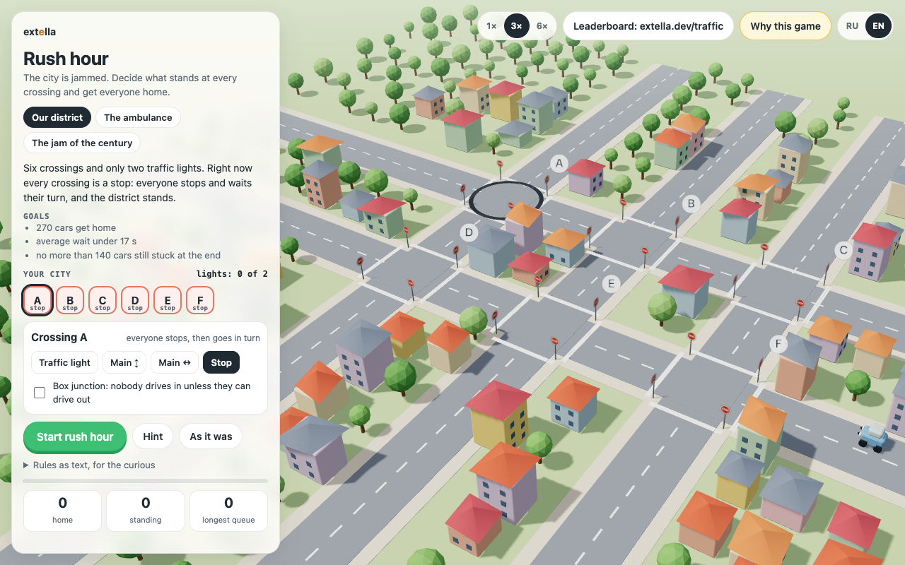

# Rush hour: traffic rules puzzle

A cartoon city is stuck in traffic. You decide what stands at each crossing (a traffic light, a main road or a stop sign), press start, and watch rush hour play out car by car. Get enough cars home with short waits and you earn up to three stars.

Play it online at [extella.dev/traffic](https://extella.dev/traffic/). The online version also keeps a leaderboard of mayors. A desktop version is in the Extella app store.



## How to play

1. Pick a level: *Our district*, *The ambulance* or *The jam of the century*.
2. Click a crossing on the panel or in the city and choose what goes there. You only get a few traffic lights per level, so put them where most cars cross.
3. For a light, pick how green is split between the two streets, or make it smart so it follows the longer queue. You can shift a light by a few seconds to build a green wave.
4. Turn on a box junction where cars drive into a crossing and get stuck inside it.
5. Press **Start rush hour**. The panel lists the level goals. When the day ends you see stars, how many cars got home, the average wait and the longest queue.

**Hint** gives you a nudge for the current level. **Copy a link to my rules** puts your whole plan into a link, so a friend can open it and try to beat you.

## Rules as text

Every choice you make in the panel is also a line in a tiny language. Open *Rules as text, for the curious* and you can edit it directly. This plan for the first level gives A a fixed light that starts 3 seconds late, B a smart light, C a main road and E a box junction:

```
# a comment
A: light, north-south 12, east-west 8, offset 3
B: light, longest queue, min 5, max 25
C: main north-south
D: stop
E: box
ambulance first
```

The game checks the text before it runs anything. A one-second green, an unknown crossing or one light too many gets rejected with a plain message, and nothing runs until you fix it. The same rules on the same level always give the same day: random numbers come from a fixed seed and the simulation uses a fixed step. That is how the online leaderboard works. The server replays your rules with its own copy of the handler and accepts the result only if it matches.

The rules also accept Russian words (светофор, главная, стоп), and the interface switches between English and Russian with the RU/EN buttons.

## Run it locally

There is no build step. Serve the folder with any static server and open it:

```sh
python3 -m http.server 8000
# then open http://localhost:8000/
```

Opening `index.html` straight from disk will not work because browsers refuse ES modules over `file://`.

A local copy runs fully offline. The leaderboard is not part of this repository: the confirm button and the mayors table are hidden, and the panel links to extella.dev/traffic instead. Shared links open the online game. If you host your own leaderboard, set `data-leaderboard-api` on the `<html>` tag to its base URL; the game will `POST {level, rules, session}` to `score` and `GET mayors?level=…`.

## Files

- `index.html`: page layout and styles
- `app.js`: the 3D city (three.js), the panel and the EN/RU texts
- `traffic_core.js`: the rules language, the checker and the simulation. It has no DOM code, so you can run it in Node.
- `vendor/three/`: three.js r160 (MIT), so the game needs no CDN

## Who made it

Rush hour comes from the team behind [Extella](https://extella.dev/), where programs are written as short rules in small languages and a handler checks and runs them. The game shows that idea on something you can play with in a minute.

## License

MIT, see [LICENSE](LICENSE). three.js is MIT, copyright three.js authors, see `vendor/three/LICENSE`.
